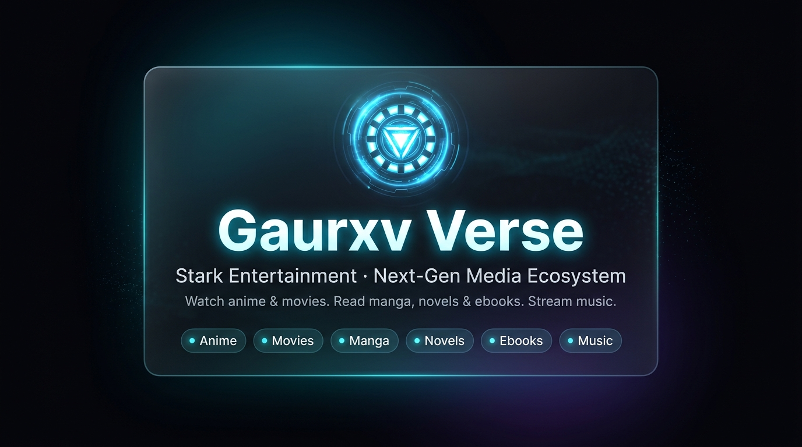

<div align="center">



<br /><br />

# Stark Entertainment / Gaurxv Verse ⎊

**Next-Gen Media Server, Universal Reader, Music Engine & Cloud Sync Platform**

*Stream anime, movies & series. Read manga, light novels & ebooks. Listen to high-fidelity ad-free music. Zero tracking, zero ads, zero compromise.*

[](https://github.com/Gaurxv-builds/Stark-Entertainment)
[](https://github.com/Gaurxv-builds/Stark-Entertainment/tree/stark-features)
[](https://github.com/Gaurxv-builds/Stark-Entertainment/releases)
[](https://github.com/Bortus-AI/Zenkai)
[](LICENSE)

[**Live Web App**](https://verse.gaurxv.eu.org) ·
[**Payment Portal**](https://payments.gaurxv.eu.org) ·
[**Android App**](https://github.com/Nyyrox/zenkai/releases/latest) ·
[**Telegram Bot**](https://t.me/JarvisXPay_Bot) ·
[**Portfolio**](https://gaurxv.eu.org) ·
[**Report an Issue**](https://github.com/Gaurxv-builds/Stark-Entertainment/issues)

<br />

</div>

---

## Overview

**Gaurxv Verse ⎊** is an all-in-one entertainment universe, digital library, and next-generation media server frontend. Designed with a deep charcoal (`#0a0a0c`), electric cyan (`#00E5FF`), and high-contrast obsidian glassmorphic aesthetic, it unifies **six distinct entertainment pillars** into a single, blazing-fast Progressive Web Application (PWA) with cross-device PostgreSQL cloud synchronization and enterprise-grade security protocols.

### The Six Pillars of Verse

| Section | Route | Theme Accent | Capabilities |
| :--- | :--- | :--- | :--- |
| **Anime** (アニメ) | `/anime` · `/home` | Electric Cyan | Trending, popular, top-rated feeds, live airing schedule, sub/dub switching, custom CinePlayer with HLS.js, WebGPU-powered Anime4K upscaling, and multi-audio stream support. |
| **Movies & TV** (映画) | `/movies` | Monochrome | Comprehensive TMDB catalogue with search, high-res posters, cast details, backdrops, and multi-source streaming resolvers. |
| **Manga** (漫画) | `/manga` | Indigo | Multi-source reader (ComicK, Manhua, Asura Scans, WeebCentral, MangaDex) with customizable layouts (Webtoon, Left-to-Right, Right-to-Left). |
| **Light Novels** (小説) | `/novel` | Amber | Clean, distraction-free light novel and web novel reader with chapter caching and typography customization. |
| **Ebooks & Documents** (電子書籍) | `/ebooks` | Emerald | Project Gutenberg & Open Library indexing with native **EPUB (`EpubReader`)** and **PDF (`PdfReader`)** readers, progress tracking, and **Indian Voice Read Aloud** (strictly 6 voices across Hindi, Indian English, and Sanskrit). |
| **Music Engine** (音楽) | `/music` | Violet | Free, high-fidelity music streaming powered by **JioSaavn** (320kbps AAC audio & 500x500 artwork) and **YouTube (Piped)**, centered floating miniplayer, dedicated queue management, and anti-conflict video pausing. |

---

## Core Architecture & Major Features

### 1. Stark Protocol Gate & Identity Architecture
- **Cryptographic Gate Authentication:** Zero-leak authentication gateway with encrypted credential verification, animated security gate, and multi-user profile synchronization.
- **Personal Email Identity Protection:** Strict security architecture enforcing that **every user must use their own personal email address** (`@gmail.com`, `@outlook.com`, etc.). The system strictly prohibits synthetic domain emails (e.g. `@gaurxv.eu.org`), preserving canonical user identity across Supabase Auth, profiles, access policies, account requests, and subscription records.
- **Interactive Application Tour (`AppTourModal`):** High-resolution interactive tour modal situated directly alongside the login gate, allowing prospective users to explore all 6 media pillars and cloud capabilities before requesting access.
- **Standardized 20-Minute Trial Clearance:** Instant 20-minute server-enforced trial clearance upon initial sign-in with countdown ticker and anti-tamper server synchronization.

### 2. Automated Account Request & Brevo Email Invitation System
- **Stark Gate Account Request Modal:** Clean, frictionless access request form where users provide their desired username, personal email, full name, and notes.
- **Instant Admin Alert via Telegram (`@JarvisXPay_Bot`):** Submits account requests directly to the authorized administrator (`895044844`) with formatted details and one-tap action buttons (`[✅ Approve]`, `[❌ Reject]`).
- **Interactive Access Policy Selection:** Upon approval in Telegram, the administrator selects one of four access policies directly via in-chat keyboard:
  - **Trial** — 20 minutes access
  - **Lifetime** — Permanent free access
  - **Subscription** — ₹29 / 30 days full clearance
  - **Custom Duration** — Administrator-specified number of days
- **Direct Brevo Email Dispatch:** The backend creates the pending auth account and dispatches an official Stark-branded invitation email via Brevo (`updates@gaurxv.eu.org`, reply-to `work@gaurxv.eu.org`) containing a cryptographically secure 48-hour single-use token.
- **Dedicated Password Setup Flow (`/auth/setup-password`):** Users click the secure link to set their own password directly. The backend validates the token, activates the profile with the approved access policy, and allows immediate login. Administrators never handle or communicate user passwords manually.

### 3. User Access Policies & Permanent Account Deletion (`/admin`)
- **Access Policy Management:** Configurable access policies (Trial, Lifetime, Subscription, Suspended) with real-time status and duration indicators.
- **Permanent Account Deletion Engine:** Administrators can permanently remove user accounts directly from the User Access Policies table.
- **Two-Step Confirmation Modal:** Displays complete user diagnostics (Username, Personal Email, User ID, Access Policy, Subscription Status) and enforces explicit confirmation before triggering cascading deletion across Supabase Auth identities, profiles, library items, reading progress, and preferences.

### 4. Cross-Device PostgreSQL Cloud Sync (Supabase)
- **Bidirectional Cloud Synchronization:** Automatically synchronizes user profiles, reading progress, library bookmarks, and settings to Supabase Cloud PostgreSQL.
- **Settings Cloud Sync Engine:** Solved the "Local Only" limitation by bridging local preferences with `user_preferences` table, complete with real-time sync status indicators and fallback offline caching.
- **Row-Level Security (RLS) Enforcement:** Every table (`user_profiles`, `user_library`, `user_reading_progress`, `user_preferences`, `account_requests`) is protected with strict RLS policies ensuring users can only read and write their own data.
- **Cross-Device Auto-Healing & Dual-Token Provisioning:** Features a multi-layer authentication recovery engine (`/api/auth/verify`) that automatically restores Supabase Gotrue sessions across mobile devices and secondary browsers without manual re-login.

### 5. Subscription & Standalone Payment Portal ([`payments.gaurxv.eu.org`](https://payments.gaurxv.eu.org))
- **Dedicated Payment Experience:** Standalone portal styled with Montserrat typography and obsidian glassmorphism.
- **Dynamic Payment Flow:** Unclipped high-resolution Paytm UPI QR code (`paytmqr6qi789@ptys`), native deep-link payment launchers (Paytm, PhonePe, Google Pay), and screenshot receipt submission.
- **Telegram Verification Bot Integration:** Payment receipts are pushed directly to `@JarvisXPay_Bot` with inline review controls (`[✅ Approve (+30 Days)]`, `[⚡ Approve & Generate Passcode]`, `[📧 Send Confirmation Email]`).

### 6. Native Ebook Reader & Indian Voice Read Aloud
- **Dual Format Viewer:** Native high-performance reader supporting both `.epub` (via `epubjs`) and `.pdf` (via `pdfjs-dist`).
- **Continue Reading Shelf:** Automatically tracks reading progress, percent completed, and current chapter across devices.
- **Strictly Controlled 6 Indian TTS Voices:**
  | Language | Female Voice | Male Voice | Locale |
  | :--- | :--- | :--- | :--- |
  | **Hindi (India)** | Hindi (India) — Female | Hindi (India) — Male | `hi-IN` |
  | **English (India)** | English (India) — Female | English (India) — Male | `en-IN` |
  | **Sanskrit (India)** | Sanskrit (India) — Female | Sanskrit (India) — Male | `sa-IN` |
  *Includes automatic EPUB metadata language detection, Devanagari verse chunking (danda `।` and double-danda `॥`), and phonetic fallback mappings.*

### 7. Gaurxv Verse Music Engine
- **JioSaavn Gateway:** Native 320kbps / 160kbps AAC direct streaming audio, 500x500 high-resolution album artwork, Bollywood, regional Indian, and trending global tracks.
- **Centered Floating Miniplayer:** Centered at the bottom of the viewport with responsive progress bar scrubbing, favorites, and instant playback controls.
- **Dedicated Queue Management:** High-performance drawer to view upcoming tracks, rearrange items, or clear the queue.
- **Anti-Conflict Audio Engine:** Intelligently pauses background music when you initiate anime or movie playback.

---

## Release Automation & CI/CD Pipeline

Stark Entertainment employs a continuous, fully automated GitHub Releases and Semantic Versioning architecture.

### Automation Workflow (`.github/workflows/auto-release.yml`)
- **Trigger Conditions:** Automatically triggers on every `push` to branch `stark-features` containing application code or configuration changes (documentation-only changes such as `**.md` are filtered via `paths-ignore`).
- **Manual Dispatch Override (`workflow_dispatch`):** Allows administrators to trigger releases with optional release bump overrides (`auto`, `patch`, `minor`, `major`), pre-release flags, or custom title descriptions.
- **Concurrency Protection:** Configured with `concurrency: group: auto-release-${{ github.ref }}` and `cancel-in-progress: false` to guarantee sequential, conflict-free version numbering.
- **Automated Quality Gates:** Executes full verification test suite (`npm test`) and production build compilation (`npm run build`) before publishing. Releases are never created if builds or tests fail.
- **Changelog & SemVer Generator (`scripts/generate-release.mjs`):** Inspects Git commits since the latest release tag, classifies changes into **Major Changes**, **New Features**, or **Minor Bug Fixes & Improvements**, increments version numbers strictly following SemVer, and publishes the release via GitHub CLI (`gh release create`).

---

## Complete Release History

Every meaningful development milestone from platform genesis to present has been reconstructed and published live on GitHub Releases:

| Tag | Date | Type | Release Title & Highlights | Commit |
| :--- | :--- | :--- | :--- | :--- |
| [**v2.5.0**](https://github.com/Gaurxv-builds/Stark-Entertainment/releases/tag/v2.5.0) | 2026-11-03 | Minor | **Automated GitHub Releases & CI/CD Pipeline**<br>Autonomous GitHub Actions auto-release workflow (`auto-release.yml`), SemVer commit classifier and changelog generator (`scripts/generate-release.mjs`), and comprehensive documentation sync. | [`bda49fb`](https://github.com/Gaurxv-builds/Stark-Entertainment/commit/bda49fb) |
| [**v2.4.0**](https://github.com/Gaurxv-builds/Stark-Entertainment/releases/tag/v2.4.0) | 2026-11-03 | Minor | **Automated Account Requests & Brevo Email Invitations**<br>Interactive Telegram bot account approval, in-chat policy selection, Brevo transactional email invitation engine, and `/auth/setup-password` user setup flow. | [`4cf56cd`](https://github.com/Gaurxv-builds/Stark-Entertainment/commit/4cf56cd) |
| [**v2.3.1**](https://github.com/Gaurxv-builds/Stark-Entertainment/releases/tag/v2.3.1) | 2026-11-02 | Patch | **Personal Email Identity Protection**<br>Strict canonical personal email preservation across Supabase Auth, profiles, policies, and gate; elimination of synthetic domain emails. | [`4a37b2c`](https://github.com/Gaurxv-builds/Stark-Entertainment/commit/4a37b2c) |
| [**v2.3.0**](https://github.com/Gaurxv-builds/Stark-Entertainment/releases/tag/v2.3.0) | 2026-11-02 | Minor | **Account Deletion, Cloud Settings & App Tour**<br>Permanent account deletion with two-step confirmation, settings cloud sync resolution, Stark Gate redesign, and 6-pillar interactive app tour. | [`1bba771`](https://github.com/Gaurxv-builds/Stark-Entertainment/commit/1bba771) |
| [**v2.2.0**](https://github.com/Gaurxv-builds/Stark-Entertainment/releases/tag/v2.2.0) | 2026-10-31 | Minor | **Subscription Portal & Telegram Bot Approval**<br>Standalone Montserrat payment portal (`payments.gaurxv.eu.org`), QR generation, `@JarvisXPay_Bot` approval engine, and Brevo receipt emails. | [`a7cab86`](https://github.com/Gaurxv-builds/Stark-Entertainment/commit/a7cab86) |
| [**v2.1.1**](https://github.com/Gaurxv-builds/Stark-Entertainment/releases/tag/v2.1.1) | 2026-10-30 | Patch | **Navigation & Auth Polish**<br>Unified 36px navigation action pills across all 6 pillars, auto-sync session healing, and Telegram bot notification improvements. | [`83d05a5`](https://github.com/Gaurxv-builds/Stark-Entertainment/commit/83d05a5) |
| [**v2.1.0**](https://github.com/Gaurxv-builds/Stark-Entertainment/releases/tag/v2.1.0) | 2026-10-29 | Minor | **Lossless Music Engine & Regional Read Aloud**<br>JioSaavn and Piped high-fidelity music streaming, centered floating player, queue management, and strict 6-voice Indian TTS reader. | [`a134f5b`](https://github.com/Gaurxv-builds/Stark-Entertainment/commit/a134f5b) |
| [**v2.0.0**](https://github.com/Gaurxv-builds/Stark-Entertainment/releases/tag/v2.0.0) | 2026-10-28 | Major | **Supabase Cloud Architecture, ePUB/PDF & PWA**<br>Full Supabase PostgreSQL cloud synchronization, native ePUB/PDF reader components, SSRF security guardrails, and PWA auto-update service worker. | [`2e48762`](https://github.com/Gaurxv-builds/Stark-Entertainment/commit/2e48762) |
| [**v1.3.0**](https://github.com/Gaurxv-builds/Stark-Entertainment/releases/tag/v1.3.0) | 2026-10-28 | Minor | **Ebooks Vault & Embedded Reader**<br>Project Gutenberg and Open Library integration, digital ebook indexing, and embedded reading view. | [`dc835f5`](https://github.com/Gaurxv-builds/Stark-Entertainment/commit/dc835f5) |
| [**v1.2.0**](https://github.com/Gaurxv-builds/Stark-Entertainment/releases/tag/v1.2.0) | 2026-10-27 | Minor | **Stark Security Gate & Cloudflare KV**<br>Passkey-protected Stark Protocol Security Gate, credential verification endpoints, and edge authentication. | [`30e0ca8`](https://github.com/Gaurxv-builds/Stark-Entertainment/commit/30e0ca8) |
| [**v1.1.0**](https://github.com/Gaurxv-builds/Stark-Entertainment/releases/tag/v1.1.0) | 2026-10-27 | Minor | **Universe Hub & Routing**<br>Hub routing architecture (`/` landing page, `/anime` route migration), unified category navigation, and UI refinements. | [`cf37f19`](https://github.com/Gaurxv-builds/Stark-Entertainment/commit/cf37f19) |
| [**v1.0.1**](https://github.com/Gaurxv-builds/Stark-Entertainment/releases/tag/v1.0.1) | 2026-10-27 | Patch | **Minor Bug Fixes & Improvements**<br>Arc Reactor branding iconography, localized navigation labels, and UI layout alignment. | [`1290450`](https://github.com/Gaurxv-builds/Stark-Entertainment/commit/1290450) |
| [**v1.0.0**](https://github.com/Gaurxv-builds/Stark-Entertainment/releases/tag/v1.0.0) | 2026-10-26 | Major | **Platform Genesis**<br>Initial project deployment of Gaurxv Verse entertainment ecosystem (Anime, Movies, Manga, and Light Novels). | [`a5197f1`](https://github.com/Gaurxv-builds/Stark-Entertainment/commit/a5197f1) |

---

## Quick Start

### Prerequisites
- **Node.js:** `v20.19.0` or higher (`v22 LTS` recommended)
- **npm:** Included with Node.js

```bash
# 1. Clone the repository
git clone https://github.com/Gaurxv-builds/Stark-Entertainment.git
cd Stark-Entertainment

# 2. Switch to the active feature branch
git checkout stark-features

# 3. Install dependencies
npm install

# 4. Start local development server
npm run dev
```

Visit [`http://localhost:5173`](http://localhost:5173) in your browser.

---

## NPM Scripts

| Command | Description |
| :--- | :--- |
| `npm run dev` | Starts Vite development server with API middleware mounted in-process. |
| `npm run build` | Type-checks with TypeScript (`tsc --noEmit`) and compiles the static site into `dist/`. |
| `npm test` | Runs the automated 23-suite verification test (`node tests/verification.mjs`). |
| `npm run preview` | Previews the compiled production build locally. |
| `npm run build:server` | Compiles the server handler bundle into `dist-server/handler.js`. |
| `npm run build:selfhost` | Compiles both client and server bundles for standalone Node deployment. |
| `npm start` | Runs the standalone Node production server (`serve.js`). |

---

## Configuration & Environment Variables

Copy `.env.example` to `.env` to configure your environment:

| Variable | Scope | Purpose | Default |
| :--- | :--- | :--- | :--- |
| `VITE_SITE_URL` | Client / Build | Canonical site URL for metadata, share cards, and sitemaps. | `https://verse.gaurxv.eu.org` |
| `VITE_SUPABASE_URL` | Client / Build | Supabase project URL for cross-device PostgreSQL sync. | Configured |
| `VITE_SUPABASE_ANON_KEY` | Client / Build | Supabase public anonymous API key for client-side queries. | Configured |
| `SUPABASE_SERVICE_ROLE_KEY` | Server Runtime | Supabase service role key for administrative auth operations. | Configured |
| `VITE_ANILIST_CLIENT_ID` | Client / Build | AniList developer client ID for OAuth progress sync. | `53784` |
| `VITE_API_BASE` | Client / Build | Remote backend origin if hosted on an external domain. | `""` (relative) |
| `TELEGRAM_BOT_TOKEN` | Server Runtime | Telegram bot token for alert dispatch & in-bot actions (`@JarvisXPay_Bot`). | Configured |
| `TELEGRAM_ADMIN_CHAT_ID` | Server Runtime | Telegram admin chat ID receiving receipts and action callbacks (`895044844`). | `895044844` |
| `BREVO_API_KEY` | Server Runtime | Brevo SMTP/REST API key for transactional emails (`updates@gaurxv.eu.org`). | Configured |
| `SHIELD_SECRET` | Server Runtime | Secret key for proof-of-work verification. If omitted, shield is off. | Unset |
| `GITHUB_TOKEN` | Server Runtime / CI | GitHub token for automated releases and API rate limit bypass. | Configured in CI |
| `SITE_PASSWORD` | Node Server | Password for the self-hosted server (`serve.js`). | Unset (public) |
| `HOST` | Node Server | Host binding address for `serve.js`. | `0.0.0.0` |
| `PORT` | Node Server | Port for `serve.js`. | `4180` |

---

## Routing Matrix

| Route | Page Component | Purpose |
| :--- | :--- | :--- |
| `/` | `LandingPage` | Universe Hub: Gate login status, profile display, and 6 media pillars entry points. |
| `/home` | `LandingPage` | Universe Hub: Gate login status, profile display, and 6 media pillars entry points. |
| `/auth/setup-password` | `PasswordSetupPage` | Dedicated token-verified user password creation portal from Brevo invitation. |
| `/anime` | `HomePage` | Anime home feed with trending, top rated, and current season. |
| `/trending` · `/popular` · `/top` | `CatalogPage` | Infinite-scroll ranked anime collections with comprehensive filters. |
| `/browse` | `CatalogPage` | Advanced anime search by genre, season, format, and status. |
| `/schedule` | `SchedulePage` | Live airing calendar synchronized to user's local timezone. |
| `/anime/:id` · `/mal/:id` | `DetailsPage` | Comprehensive anime details, characters, relations, and episodes. |
| `/watch/:id` | `WatchPage` | Immersive full-bleed anime player with Anime4K and multi-audio. |
| `/movies` · `/movies/browse` | `MoviesHomePage` | Film and television catalogue powered by TMDB. |
| `/movies/:type/:id` | `MovieDetailsPage` | Movie and series details, trailers, cast, and recommendations. |
| `/movies/watch/:type/:id` | `MovieWatchPage` | Multi-source movie & TV streaming player. |
| `/manga` · `/manga/:id` | `MangaHomePage` | Manga catalogue across five reader sources. |
| `/manga/:id/read/:chapterId` | `MangaReaderPage` | Full-screen multi-mode manga reader (Webtoon / LTR / RTL). |
| `/novel` · `/novel/:source/:slug` | `NovelHomePage` | Light novel and web novel catalogue. |
| `/novel/:source/:slug/read/:chapter` | `NovelReaderPage` | Focused, clean text reader with night mode and chapter navigation. |
| `/ebooks` | `EbooksHomePage` | Digital ebook library with Project Gutenberg & Open Library indexing. |
| `/ebooks/read/:id` | `EbookReaderPage` | Full-screen EPUB/PDF reader with strict 6-voice Indian Read Aloud. |
| `/music` | `MusicPage` | Ad-free music discovery, search, centered miniplayer, and audio player engine. |
| `/list` · `/profile` | `ListPage` / `ProfilePage` | User profile, watchlist, continue-reading shelf, and AniList / Supabase sync. |
| `/admin` | `AdminPage` | Dual-tab admin console: Subscription & Access Center and User Access Policies. |
| `/app` | `AppPage` | Android application release notes, APK downloads, and updates. |
| `https://payments.gaurxv.eu.org/` | Standalone Portal | Standalone Montserrat glassmorphic payment portal with unclipped QR, UPI intent, and receipt upload. |

---

## Testing & Verification

The repository includes an end-to-end automated test harness covering all major subsystems:

```bash
npm test
```

**Test Coverage (23 Subsystems):**
1. Supabase Client & Configuration Verification
2. SQL Migration & Row Level Security (RLS) Schema Integrity
3. Cross-Device Cloud Sync Module
4. Native EPUB & PDF Reader Components
5. SSRF Security Guardrails & Domain Filtering
6. PWA Offline Caching & Manifest
7. Media Connectors (Trakt, Jellyfin, Komga)
8. Music Engine (JioSaavn & Piped Resolvers, Audius Absence)
9. Global Persistent Audio Engine & Anti-Conflict Logic
10. Music UI Components, Hero & Category Shelves
11. Stark Gate Profile Display & Session Persistence
12. Strict Six Indian Voice TTS Engine & Language Detection
13. Stark Subscription, Payment Portal & Access Management Verification
14. Multi-device Admin Authentication & Payment Queue Resilience
15. Telegram Bot Direct Approval & In-Chat Action Engine
16. Permanent Account Deletion Engine & Safeguards
17. Canonical Personal Email Preservation & Zero Domain Synthesis Guard
18. Settings Cloud Sync & Accurate Sync Status
19. Stark Gate Redesign & Account Request Workflow
20. Application Preview / Interactive Tour (`AppTourModal`)
21. 20-Minute Standardized Trial Duration
22. Automated Brevo Invitation System & Password Setup Flow
23. GitHub Actions Auto-Release Workflow & Release Configuration

---

## Contributing & Branch Guidelines

1. **Target Branch:** All contributions and feature development must target `stark-features`.
   ```bash
   git checkout stark-features
   ```
2. **Quality Gates:** Verify all tests and builds pass before pushing:
   ```bash
   npm test
   npm run build
   ```
3. **Automated Releases:** Pushing code changes to `stark-features` automatically triggers the GitHub Actions release workflow. Ensure commit messages clearly indicate features (`feat: ...`), fixes (`fix: ...`), or breaking changes (`feat!: ...` or `BREAKING CHANGE: ...`).

---

## License & Disclaimer

- **License:** Distributed under the [MIT License](LICENSE).
- **Disclaimer:** Gaurxv Verse does not host, upload, or store any video, audio, ebook, manga, or novel media files. It functions exclusively as a client-side interface linking to third-party public indexing services and APIs. All artwork, trademarks, and titles belong to their respective copyright holders.
- **Upstream:** Gaurxv Verse is forked from [Bortus-AI/Zenkai](https://github.com/Bortus-AI/Zenkai) (originally created by [Nyyrox](https://github.com/Nyyrox)).
